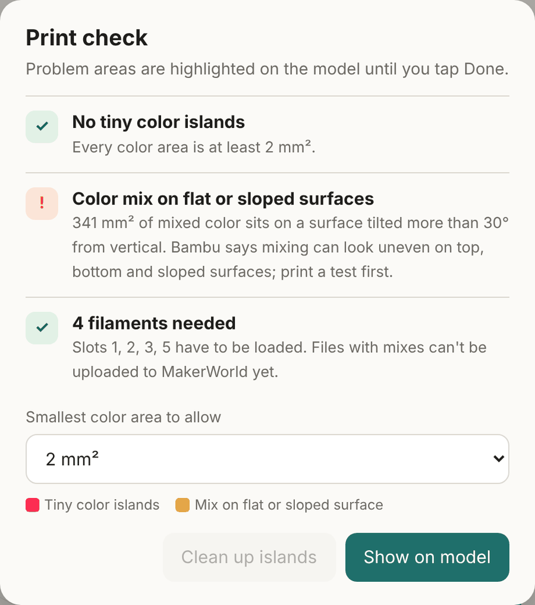

# Exporting and print check

## Print check

Before you export, tap **Check** in the top bar. It looks for three things:

- **Tiny color islands**: little specks of color smaller than the **Smallest color area to allow** (1, 2, 5 or 10 mm²). Each one forces extra filament swaps and may be too small to print cleanly. **Clean up islands** merges them into the color around them. Shading patterns aren't counted, since their specks are on purpose.
- **Color mix on flat or sloped surfaces**: mixed colors on surfaces tilted more than 30° from vertical. Mixing can look uneven on tops, bottoms and slopes, so print a test first. (Why: see [Tips and known limits](Tips-and-limits).)
- **Filaments needed**: which filament slots have to be loaded to print this model.

**Show on model** highlights the problems: islands in red, mixes on slopes in orange. Tap **Done** to go back to your colors.

## Export for Bambu Studio

With the printer set to **Bambu AMS**:

1. Tap **Export 3MF**.
2. Type a file name and tap **Export**. The .3mf is saved to your Downloads (on iPad, the Files app).
3. Open it in **Bambu Studio**. The model opens painted, with your filaments and mixed filaments set up.
4. **Set each filament to your real filament preset** (Bambu PLA Basic, Matte and so on) before slicing.

If you opened a Bambu Studio 3MF, or used **Load palette**, the export keeps that project's print and printer settings.

Files with mixed filaments can't be uploaded to MakerWorld yet; that's a MakerWorld limit.

## Export for Snapmaker Orca and Full Spectrum

With the printer set to **Toolchanger**, **Export 3MF** saves a **Snapmaker Orca** project (version 2.3.3 or newer) for the Snapmaker U1:

- Your filaments go on heads 1 to 4.
- Your mixes become Full Spectrum mixed filaments.

The same file opens in the [Full Spectrum fork of OrcaSlicer](https://github.com/ratdoux/OrcaSlicer-FullSpectrum), where you can switch the printer, for example to a Flashforge Creator 5. Set your real filament presets and nozzle in the slicer.

A toolchanger holds 4 filaments. If your palette has more, CthulHue asks you to **set up 4 toolheads** first. See [Toolchangers](Toolchangers).

## Exporting from inside Claude

If you use the copy of CthulHue that runs inside Claude, the browser can only save .zip files there. You'll get a file like `Painted model.3mf.zip`. Rename it to end in `.3mf` (in Files: press and hold, then Rename) and open it in your slicer. The GitHub site, https://labcraftstudio.github.io/CthulHue/, saves real .3mf files.
