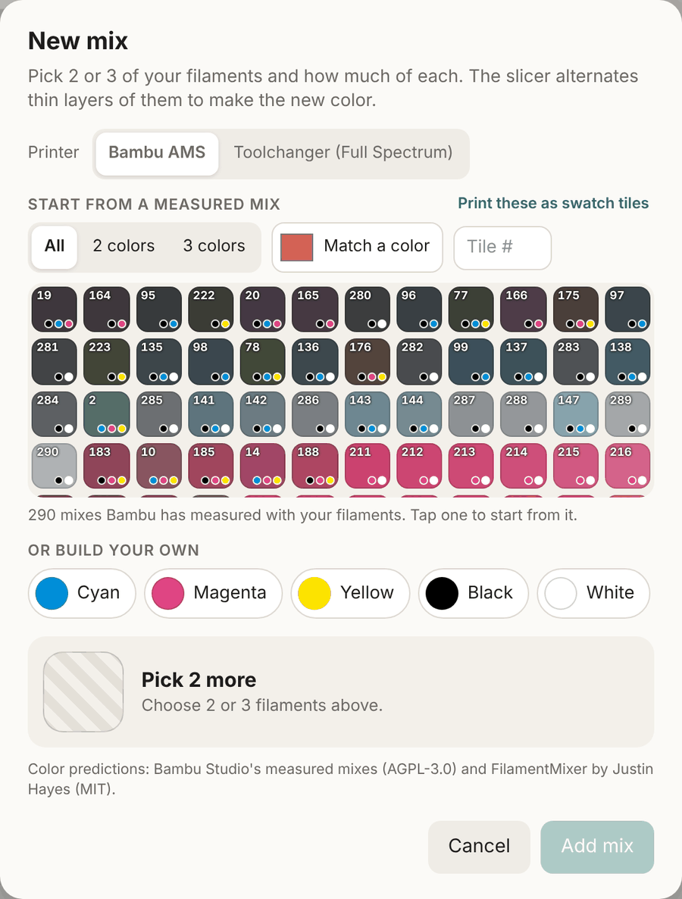

# Filaments and mixes

The **Filaments** panel on the right is your palette. It lists your real spools first, then your mixed colors. Tap a color to paint with it. Your palette is saved in your browser, so it's there next time.

## Real filaments

**+ Add filament** adds a spool for your AMS or a toolhead.

- Switch between **Bambu Lab** (154 PLA colors: Basic, Matte, Silk, Translucent, Sparkle and more) and **Polymaker Panchroma**.
- Search by color or line, for example "teal", "matte" or "silk gold".
- Or make a **custom color** and give it a name, like "Elegoo Rapid Teal".

New filaments go after your other filaments and before the mixes, because Bambu Studio needs every real spool listed before the mixes. CthulHue renumbers your paint to match, so nothing on the model changes color.

**Edit** on a filament renames or removes it. **Rename** at the top of the panel names several filaments at once; names are saved on this device and follow each color.

**Reset to default filaments** at the bottom brings back the starting palette.

## Mixed colors

A mix is a new color made from 2 or 3 of your filaments. The slicer prints thin alternating layers of them, and from a little distance your eye blends them into one color. This is how Bambu Studio's mixed filaments and Full Spectrum work.

**+ New mix** opens the mix sheet:

- **Start from a measured mix**: a gallery of ready-made mixes. With **Bambu AMS** and Bambu PLA Palette filaments, these are colors Bambu measured from real prints. Otherwise they're predicted from your filaments' colors.
  - Filter by **All**, **2 colors** or **3 colors**.
  - **Match a color**: pick any color and the gallery sorts to the closest mixes.
  - **Tile #**: jump to the mix on a numbered swatch tile.
- **Or build your own**: choose the filaments and how much of each.

**Edit** on a mix changes its recipe. Changing a recipe recolors everything painted with it.

Limits (from Bambu Studio): up to 3 filaments per mix and 64 mixes in one project.

Mix colors on screen are predictions. Real prints depend on your filaments, layer height and lighting, so print the swatch tiles (below) to see the real thing.

## Shading

When you use the **Soft** brush or a **Gradient** fill, CthulHue creates the in-between colors for you as mixes (**Shade steps** sets how many, 2 to 6). They're grouped under their filaments in the panel, and you can collapse each group.

Shading prints as a pattern rather than flat bands of color:

- On walls, the steps alternate in thin horizontal stripes that line up with the print layers.
- On flatter surfaces, they form a fine dot pattern.

From normal viewing distance the steps blend into a smooth fade. CthulHue also cleans up specks too small to print well.

If you remove shading, its mixes stay in the palette. **Remove N unused shades** on each group clears them out.

## Swatch tiles

To see what Bambu's mixes really look like, print the swatch tiles: numbered tiles for all 290 Bambu PLA Palette CMYKW mixes (Cyan, Magenta, Yellow, Black and White), plus frames to hold them.

In the app: **+ New mix** → **Print these as swatch tiles** → **Download print files**. The zip (about 1 MB) has:

- **Tile sets 1–5**, each with 58 mixes and 10 pure-color tiles
- **Triangle frames**, and either **pair strips** or one **pair board**
- Assembly guides, a read-me, and the tile key as a spreadsheet (CSV)

Each tile's number matches **Tile #** in the mix gallery. Pocket clearance is 0.03 mm per side.

## Load a palette from Bambu Studio

**Load palette** (top bar) copies the filament setup from a Bambu Studio project (.3mf). Only the filaments and settings are used, not the model.

It replaces your filament list and the print and printer settings your exports use. Painted areas keep their filament numbers, so they take the new list's colors; areas using a number the new list doesn't have go back to filament 1. **Undo doesn't reverse a palette change**, so export first if you want to keep the old version.
