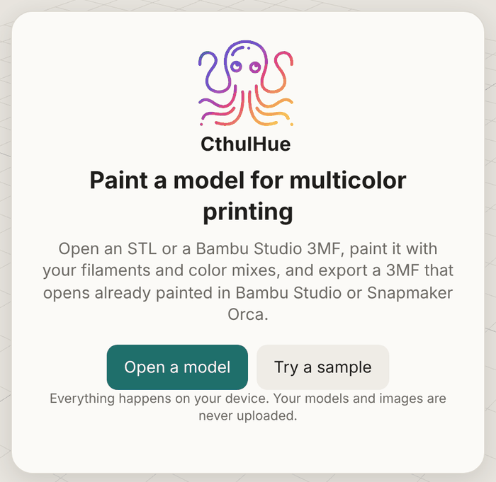

# Getting started

This walks you through one model from start to finish. It takes about five minutes with the sample.

## 1. Open a model

Go to **https://labcraftstudio.github.io/CthulHue/** and tap **Open a model**, or **Try a sample** to paint the octopus.

CthulHue opens:

- **STL** files.
- **3MF** files saved by Bambu Studio. Paint and filament settings already in the file come along. Modifier parts are left out.

If the 3MF was set up with different filaments than yours, CthulHue asks which to use: **Use the file's filaments**, or **Keep mine, match colors** (each painted color is moved to the closest one in your palette).

To open a different model later, use **Open** at the top left.

## 2. Pick your printer

At the bottom of the **Filaments** panel, set **Printer**:

- **Bambu AMS** for Bambu Lab printers with an AMS.
- **Toolchanger** for 4-head printers like the Snapmaker U1 or Flashforge Creator 5. See [Toolchangers](Toolchangers).

This changes how mixed colors are predicted and which slicer the export is for.

## 3. Set up your filaments

The **Filaments** panel on the right is your palette: the spools you'll load, followed by any mixed colors.

- **+ Add filament**: pick from Bambu Lab PLA or Polymaker Panchroma colors, search by name ("teal", "matte", "silk gold"), or make a custom color.
- **+ New mix**: make a new color from 2 or 3 of your filaments. See [Filaments and mixes](Filaments-and-mixes).
- Tap a color to paint with it. Tap **Edit** on a color to rename or remove a filament, or change a mix recipe.

Already have filaments set up in Bambu Studio? **Load palette** (top bar) copies the filament setup from any Bambu Studio project.

## 4. Paint

Choose a tool in the **Tools** panel on the left:

- **Brush** paints where you touch. **Hard** gives clean edges; **Soft** shades.
- **Fill** colors a whole area at once.
- **Image** projects a picture onto the model.
- **Select** picks an area or draws a shape, so you can paint only inside it.

With Apple Pencil, **the Pencil paints and your fingers turn and zoom** the model. With a mouse, left-click paints, right-drag turns, and Shift + right-drag pans.

Made a mistake? **Undo** and **Redo** are in the top bar. On iPad, a two-finger tap undoes and a three-finger tap redoes; on a computer use ⌘Z / Ctrl+Z.

All the details are on [Painting tools](Painting-tools).

## 5. Check and export

1. Tap **Check** in the top bar. It finds tiny color specks that would waste filament swaps and offers to clean them up. See [Exporting and print check](Exporting).
2. Tap **Export 3MF**, name the file, and tap **Export**.
3. Open the file in Bambu Studio (or Snapmaker Orca). It opens already painted.
4. **In the slicer, set each filament to your real filament preset** before slicing. CthulHue knows the colors, not your exact filament settings.

That's it. Happy printing!
