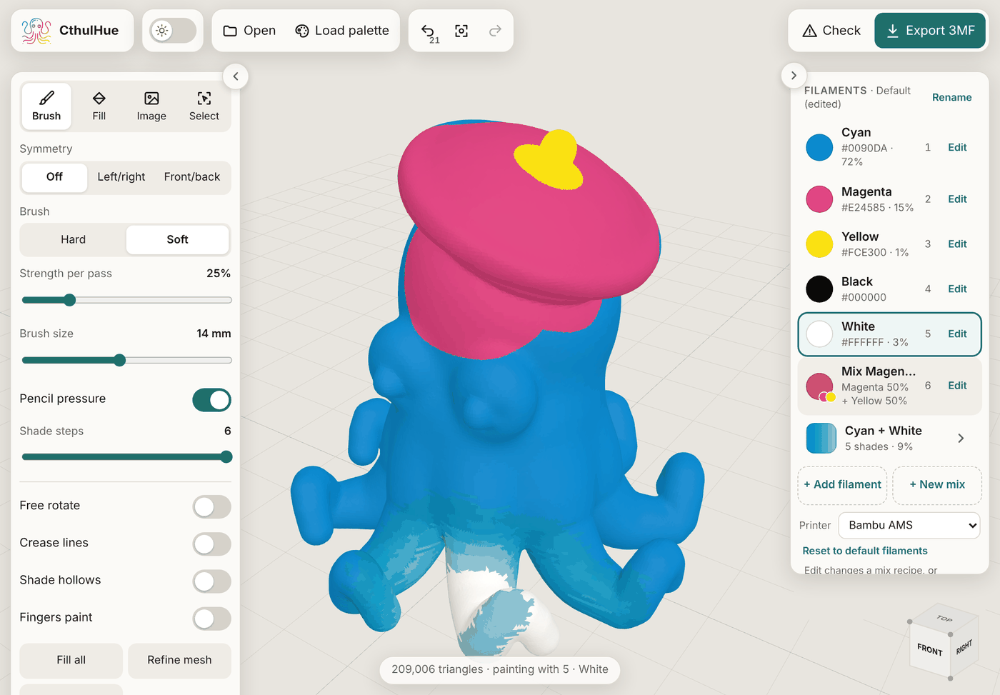

# CthulHue help

**CthulHue** (say *kuh-THOOL-hyoo*) lets you paint 3D models for multicolor printing, right in your browser. Open a model, paint it with your filaments and color mixes, and export a project that opens already painted in your slicer.

**Open the app: https://labcraftstudio.github.io/CthulHue/**

It's made for iPad and Apple Pencil, and works with a mouse on a computer too. Everything runs on your device: your models and images are never uploaded.

## Start here

- [Getting started](Getting-started): your first painted model, from opening a file to printing it
- [Painting tools](Painting-tools): Brush, Fill, Image and Select, symmetry and the view controls
- [Filaments and mixes](Filaments-and-mixes): your palette, mixed colors, shading and swatch tiles
- [Exporting and print check](Exporting): saving for Bambu Studio or Snapmaker Orca, and catching problems first
- [Toolchangers](Toolchangers): Snapmaker U1, Flashforge Creator 5 and Full Spectrum mixing
- [Tips and known limits](Tips-and-limits): what prints well and what doesn't (yet)
- [FAQ and troubleshooting](FAQ)
- [For developers](For-developers): how the code is organized

## Which slicers and printers?

| You print with | Choose this printer in CthulHue | Export opens in |
| --- | --- | --- |
| A Bambu Lab printer with an AMS (for example the H2C or H3C) | Bambu AMS | Bambu Studio |
| Snapmaker U1 | Toolchanger | Snapmaker Orca 2.3.3 or newer |
| Another toolchanger, like the Flashforge Creator 5 | Toolchanger | The [Full Spectrum fork of OrcaSlicer](https://github.com/ratdoux/OrcaSlicer-FullSpectrum) |

## Problems and ideas

Found a bug or have an idea? Please [open an issue](https://github.com/LabcraftStudio/CthulHue/issues). It helps to say which device and browser you used and, if you can, attach the model.

CthulHue is free software under the AGPL-3.0 license, made by Sarah at Labcraft Studio.
