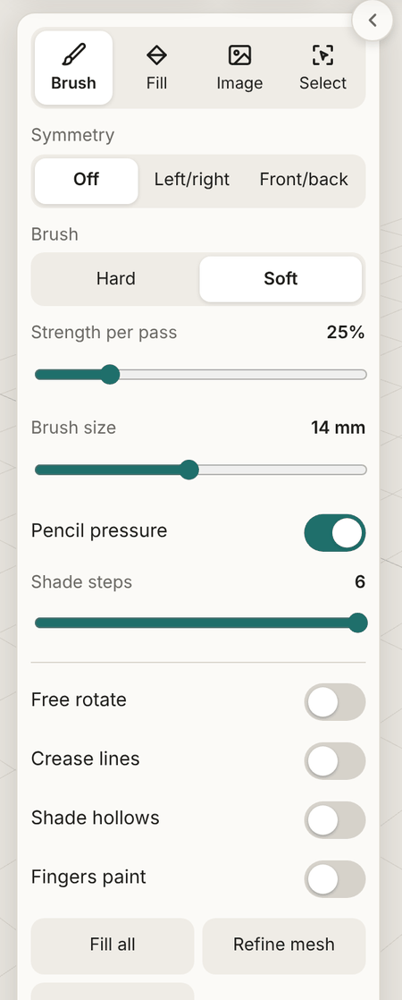

# Painting tools

The **Tools** panel is on the left. Pick a tool at the top; the options below it change to match. A short hint at the bottom of the panel reminds you how the current tool works. The arrow at the panel's top corner collapses it when you need more room.

## Moving around

| | iPad | Mouse |
| --- | --- | --- |
| Paint | Apple Pencil | Left-click and drag |
| Turn the model | One finger | Right-drag |
| Zoom | Pinch | Scroll wheel |
| Pan | Two fingers | Shift + right-drag |
| Undo / Redo | Two-finger tap / three-finger tap | ⌘Z / ⇧⌘Z (Ctrl on Windows) |

- **Fit** (top bar, between Undo and Redo) brings the whole model back into view.
- **View cube** (bottom-right corner): tap a face to look straight at it, tap a corner dot for an angled view, or drag it to turn. When you're looking straight at a face, arrows on its edges step to the neighboring faces. This is the easiest way to line up a flat side for the Image tool.
- **No Pencil?** Turn on **Fingers paint** at the bottom of the Tools panel. Then one finger paints and two fingers turn and zoom.

## Brush

- **Hard** paints solid color with a clean edge. When you lift, CthulHue refines the mesh along your stroke so the edge follows the shape you drew, not the model's triangles.
- **Soft** shades toward the current color a little more with each pass. Paint over shading with the area's own color to fade it back.
  - **Strength per pass**: how much each pass shades.
  - **Shade steps** (2 to 6): how many in-between mixes the shading uses. More steps blend more smoothly but add more mixes to your palette.
- **Brush size**: in millimeters on the model. On a keyboard, `[` and `]` make it smaller and bigger.
- **Pencil pressure**: press harder for a bigger brush.

Soft shading prints as real mixed colors arranged in a fine pattern. See [Filaments and mixes](Filaments-and-mixes#shading).

## Fill

- **Solid**: tap a color area and it fills with the current color. Fill only spreads over the color you tapped, so neighboring colors stay as they are. Hover with the Pencil or mouse to preview first.
  - **Shading counts as one color**: fill a color together with any shading on it.
  - **Also stop at sharp edges**: the fill stops where the surface folds more than the **Edge angle**. Handy for painting one face of a box.
- **Gradient**: start on a color and drag. That color area shades from its own color where you start to the current color where you lift.
  - **Shade steps** works as for the Soft brush.
  - **Smooth up/down (Bambu gradient)**: instead of stepped mixes, Bambu Studio blends two plain filaments layer by layer from bottom to top. Bambu AMS only, and both colors must be plain filaments (not mixes).

## Image

Put a picture on the model, like a decal.

1. Turn the model so the surface you want faces you. The view cube helps.
2. Tap **Choose image**. It appears see-through over the model.
3. Drag it to move it. Pinch, twist, or drag the blue corner handle to resize and turn it.
4. Touch outside the image to turn the model, or turn on **Lock image** so fingers always turn the model.
5. Tap **Apply to model**.

Options:

- **See-through**: how transparent the image looks while you place it. It doesn't change the result.
- **Detail** (0.3 to 1.5 mm): how finely the model is divided under the image. Smaller is sharper but makes a heavier file.
- **Colors**: **My colors** uses only your current palette. **Add mixes** also adds **up to** the number of mixes you choose that best match the picture.

Good to know:

- Only surfaces facing you are painted. Walls of grooves that face sideways are skipped; apply again from another angle to reach them.
- See-through parts of a PNG keep the paint underneath, so logos with transparent backgrounds work well.
- If you have a selection, the image only goes inside it.
- Photos come out posterized, since every color has to be a filament or a mix. Simple artwork with few colors works best.
- **Remove** takes the image away without applying it.

## Select

- **Tap a color area** to select it.
- **Draw around an area** to select a shape. **Streamline** smooths out hand wobble; **Line detail** sets how crisp the shape's edge is.
- **Shapes**: **New** starts over with each stroke, **+ Add** adds to the selection, and **− Subtract** cuts away from it.

The selection gets a blue outline, and a bar appears at the bottom of the screen:

- **Paint**: fill the selection with the current color.
- **Grow** / **Shrink**: make a one-color area bigger or smaller by the **Grow / shrink step**.
- **Smooth edge**: smooth jagged color edges inside the selection (the **Edge smoothing** slider sets how much).
- **Same color everywhere**: select every area of this color on the whole model.
- **Merge into surroundings**: repaint the area with the color around it. Good for removing stray specks.
- **Done**: drop the selection.

While something is selected, **Brush**, **Fill** and **Image** only paint inside it. Tap **Done** to paint anywhere again.

## Symmetry

Available for Brush and Select. Choose **Left/right** or **Front/back** and every stroke is mirrored across the blue plane. **Place mirror** moves the plane: tap the model where the mirror should go, or tap two matching spots (like both eyes) to put it halfway between them, then tap **Done**. **Center** puts it back in the middle of the model.

## View options and extra buttons

At the bottom of the Tools panel:

- **Free rotate**: one finger tumbles the model in any direction. Off (turntable mode) keeps it upright. **Fit** stands it upright again.
- **Crease lines**: draws the model's sharp edges, to help you see where to paint.
- **Shade hollows**: darkens hollows and grooves so small details are easier to see. It's only a view aid, not paint.
- **Fill all**: paints the whole model with the current color.
- **Refine mesh**: splits every triangle into four for finer painting. Use it when a low-poly model makes edges blocky. Each refine makes the file bigger.
- **Smooth edges**: smooths jagged color edges over the whole model. Edges along sharp creases and corners are kept as they are.

## Keyboard shortcuts

| Key | Does |
| --- | --- |
| `b` | Brush |
| `f` | Fill |
| `s` | Select |
| `[` / `]` | Smaller / bigger brush |
| `1` to `9` | Pick filament 1 to 9 |
| ⌘Z / Ctrl+Z | Undo |
| ⇧⌘Z / Ctrl+Shift+Z | Redo |
