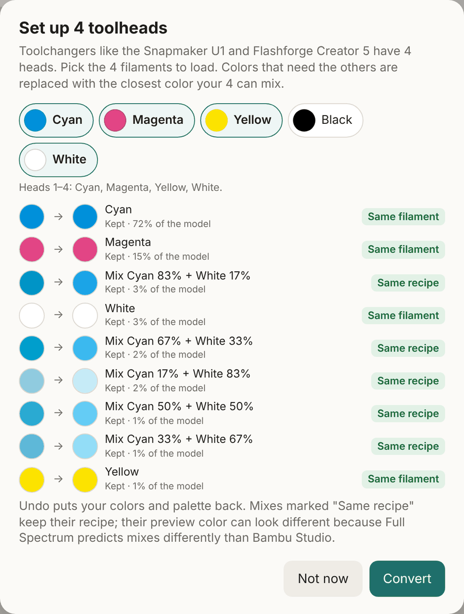

# Toolchangers

CthulHue also works with 4-head toolchangers that mix colors with **Full Spectrum**:

- **Snapmaker U1**, with Snapmaker Orca 2.3.3 or newer (Full Spectrum is built in).
- **Flashforge Creator 5** and other toolchangers, with the [Full Spectrum fork of OrcaSlicer](https://github.com/ratdoux/OrcaSlicer-FullSpectrum).

Toolchangers waste far less filament on color changes than a single-nozzle printer, which makes them great for heavily mixed and shaded models.

## Switch to Toolchanger

Set **Printer** to **Toolchanger** at the bottom of the Filaments panel, or at the top of the New mix sheet. Then:

- Mix colors are predicted the same way Full Spectrum previews them.
- The mix gallery shows mixes of your own filaments: every pair in 10% steps and every three in 20% steps.
- **Export 3MF** saves a Snapmaker Orca project.
- **Smooth up/down** (Bambu's gradient) is hidden, because it's Bambu-only.

## Set up 4 toolheads

A toolchanger holds 4 filaments. If your palette has more, CthulHue offers to convert it when you switch, and again when you export.

1. Pick the 4 filaments to load.
2. The list shows what happens to each color on your model, and how much of the model uses it:
   - **Same filament** or **Same recipe**: kept as it is. A mix's preview color can look a little different, because Full Spectrum predicts mixes differently than Bambu Studio.
   - **Becomes** a mix of your 4, rated **Very close**, **Close**, **Noticeable** or **Far off**.
3. If some colors are far off, try a different set of 4, or keep the filament they need.
4. Tap **Convert**. One **Undo** puts your colors and palette back.

## Tips for toolchangers

- Thin layers (0.08 to 0.12 mm) blend mixed colors best.
- Translucent filaments blend better than opaque ones.
- For a big palette, pick 4 filaments that span your colors: for example cyan, magenta, yellow and white.
